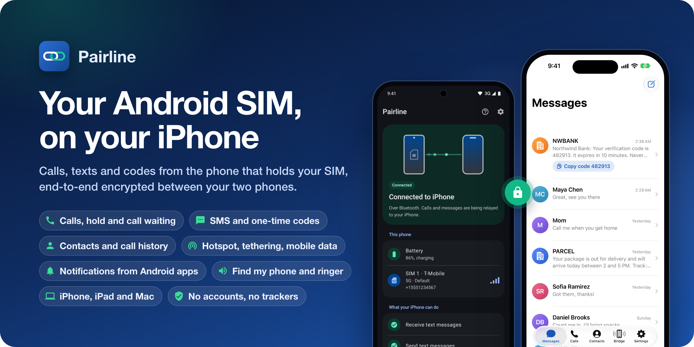

# Pairline

Use your Android phone's SIM card on your iPhone — calls, SMS, contacts and more — over an
end-to-end encrypted link between your own two phones.

  

## Download

| App | Get it | Needs |
|-----|--------|-------|
| **Pairline Bridge** for the Android phone with the SIM (free) | **[Download the latest APK](https://getpairline.com/download/android)** · [latest release on GitHub](https://github.com/mirzaaghazadeh/pairline/releases/latest) · [all versions](https://github.com/mirzaaghazadeh/pairline/releases) | Android 9 or later |
| **Pairline** for iPhone, iPad and Mac | **[Get it on the App Store](https://getpairline.com/download)** | iOS 16 or later |

Both links always point to the newest release. Each release's notes list the APK's SHA-256, its signing
certificate and its [VirusTotal](https://www.virustotal.com) report; see [Verifying releases](#verifying-releases).
Progress: [docs/ROADMAP.md](docs/ROADMAP.md).

## What it does

Everything goes through the Android phone's SIM, so the people you call and text see that phone's number.

- **Nearby or anywhere:** with the phones near each other they talk directly over Bluetooth and Wi-Fi. With
  **Cloud mode** the Android phone can stay at home on its charger, and your iPhone still gets calls, texts and codes,
  and calls and texts back, from anywhere with internet.
- **Calls** on the iPhone's own call screen: answer, decline, hold, call waiting and swap, and move the sound to a
  headset or the car. With **Talk on iPhone** you hear and talk on the iPhone itself, over Bluetooth or Wi-Fi.
- **Call back from the iPhone's Recents**, with Siri ("Call with Pairline") or from a Shortcut.
- **SMS:** your conversations, one tap to copy a one-time code, reply from the notification, mute a conversation,
  messages you read marked read on Android too, and export to a text file or CSV.
- **Contacts and call history** from the Android phone; add, edit and star contacts from the iPhone.
- **USSD codes** (balance, top-ups), both SIMs on a dual-SIM phone, and the bridge's signal and battery, also as a
  Live Activity on the Lock Screen.
- **Internet:** share the Android phone's connection with the iPhone, and turn its hotspot, Bluetooth tethering, mobile
  data and data SIM on or off from the iPhone.
- **Notifications from the Android apps you choose**, on the iPhone; dismiss one and it goes away on both phones.
- **Find my phone** makes the Android phone ring loudly; switch its ringer between ring, vibrate and silent.
- **Files** both ways over Wi-Fi, from the share sheet.
- **iPad and Mac:** the same app runs on iPad, and on Macs with Apple silicon.

Hearing calls on the iPhone, the internet switches and read status on Android need Talk on iPhone (see below).

## Our promise

- **Your data stays on your phones.** Messages, contacts, call history and call audio go only
  between your two paired phones. They never touch our servers — in version 1 we don't run any. In Cloud mode they
  pass through your own iCloud locked, so only your two phones can open them.
- **No accounts, no analytics, no ads, no trackers.**
- **No settings changed behind your back.** Pairline changes no system setting you didn't ask for. The one
  exception is Talk on iPhone: once you've set it up, and only while it's on, it turns Developer options and
  debugging back on when its helper needs them. Turn Talk on iPhone off and that stops. The Android phone's hotspot,
  mobile data and ringer change only when you flip that switch on the iPhone.
- **No silent updates.** Android asks you before every update is installed.
- **Check it yourself.** The full source is here. [docs/PRIVACY.md](docs/PRIVACY.md) lists every
  data flow and every permission, and why it's needed.

## How it works

1. Install the free **Pairline Bridge** app on the Android phone that has the SIM card.
2. Install **Pairline** on your iPhone.
3. Pair them once by scanning a QR code. The two phones exchange keys; nobody else ever sees them.
4. Incoming calls ring on your iPhone's normal call screen, and SMS arrive in the Pairline app.
5. Optional, on Android 11 or later: set up **Talk on iPhone** once to hear and talk on the iPhone itself.
   Pairline starts a small helper through the Android phone's own Wireless debugging: no root and no other app
   (a rooted phone can start it through its own `su` instead, under Settings › Advanced).
   While the iPhone is linked, the Android phone stops ringing too ("Ring only on the iPhone", on by default).

### Two ways to connect

- **Nearby** works by itself, for example with the Android phone in your bag or on your desk. The phones talk over
  Bluetooth LE, call audio included. Local Wi-Fi (or the Android phone's own hotspot) carries files, and call audio too
  if you choose it.
- **Cloud mode**, for example with the Android phone at home while you're at work or travelling. Turn it on in the
  iPhone app, during pairing or later in Settings, and leave the Android phone on its charger and Wi-Fi. Calls, texts
  and codes keep reaching your iPhone anywhere, and you call and text back. There is still no Pairline server:
  messages travel as locked records through your own iCloud, which only your two phones can open, and calls go
  straight to your home through one port your router opens for your paired iPhone alone. Most routers open it by
  themselves; for the rest the app shows how to do it by hand. [docs/PRIVACY.md](docs/PRIVACY.md) lists exactly what
  Apple and your router see.

Both can be on: near each other the phones use Bluetooth and Wi-Fi, and Cloud mode takes over when you leave.
Details: [docs/ARCHITECTURE.md](docs/ARCHITECTURE.md) and [docs/PROTOCOL.md](docs/PROTOCOL.md).
A three-minute intro video, in English, Persian, Turkish and Arabic, is on [getpairline.com](https://getpairline.com).

## Pricing

- **Android app:** free.
- **iPhone app:** free download. Pair your Android phone first: the first sync of your messages, contacts and call
  history is free, then a free week with every feature, Cloud mode included. After that, Full Access is a one-time
  $9.99 In-App Purchase with free updates. No subscription. Demo mode is always free.
- **Cloud mode:** add it at your first purchase and pay $19.99 for both (instead of $29.98, about 33% off), or add it
  later as a one-time $19.99 add-on to Full Access. No subscription.

## License

Pairline is **source-available** under the
[Functional Source License 1.1 (FSL-1.1-ALv2)](LICENSE.md):

- You **may** read, audit, build and modify the code for personal, internal, educational or
  research use.
- You **may not** sell it, or use it to offer a competing product or service.
- Each release automatically becomes **Apache-2.0** two years after it's published.
- The name and logo are trademarks and aren't covered by the license.

## Contributing and help

Issues and pull requests are welcome; the maintainer reviews every change before it goes in. Read
[AGENTS.md](AGENTS.md) first: its privacy and security rules apply to every change.

Questions and news on Telegram: the [help group](https://t.me/pairline_groups) and the news channel in
[English](https://t.me/pairline_en), [Persian](https://t.me/pairline_fa) or [Turkish](https://t.me/pairline_tr).

Thanks to Sayyad Abbasi and Amirreza Azadmehr for testing on real phones and helping with the final debugging.

## Verifying releases

Android APKs are built and signed only by GitHub Actions from a tagged commit. Each release's notes link the
build run and list the APK's SHA-256, the signing-certificate fingerprint and the APK's VirusTotal report.
How to check them: [SECURITY.md](SECURITY.md#verifying-a-release).

## Documentation

| Document | What's in it |
|----------|--------------|
| [docs/ARCHITECTURE.md](docs/ARCHITECTURE.md) | How the two apps are built and how they connect |
| [docs/PROTOCOL.md](docs/PROTOCOL.md) | Pairing, encryption and message format |
| [docs/PRIVACY.md](docs/PRIVACY.md) | Every data flow and permission |
| [docs/ROADMAP.md](docs/ROADMAP.md) | Milestones and current progress |
| [docs/DECISIONS.md](docs/DECISIONS.md) | Why things are the way they are |
| [SECURITY.md](SECURITY.md) | Reporting vulnerabilities, verifying releases |
| [AGENTS.md](AGENTS.md) | Rules for contributors and coding agents |
