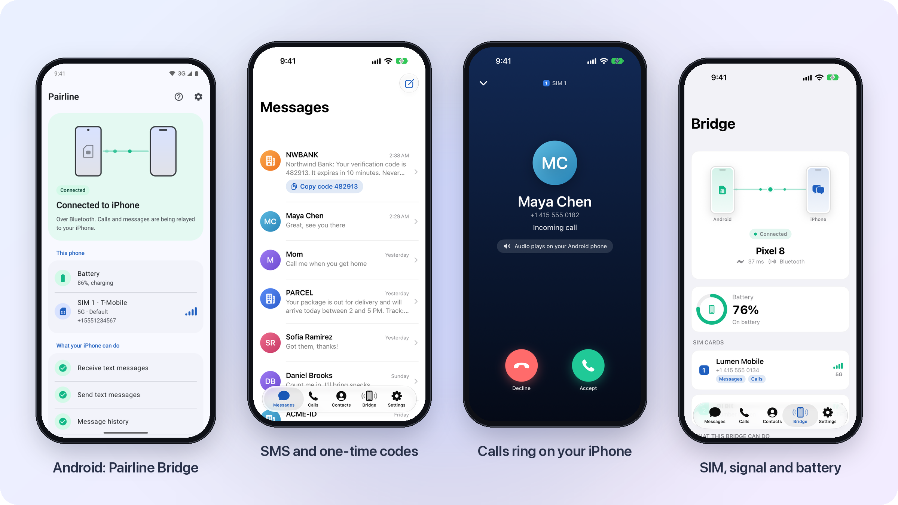

# Pairline

Use your Android phone's SIM card on your iPhone — calls, SMS, contacts and more — over an
end-to-end encrypted link between your own two phones.

  

## Download

| App | Get it | Needs |
|-----|--------|-------|
| **Pairline Bridge** for the Android phone with the SIM (free) | **[Download the latest APK](https://pairline.navid.tr/download/android)** · [latest release on GitHub](https://github.com/mirzaaghazadeh/pairline/releases/latest) · [all versions](https://github.com/mirzaaghazadeh/pairline/releases) | Android 9 or later |
| **Pairline** for iPhone | Coming soon to the App Store · [pairline.navid.tr](https://pairline.navid.tr/download) | iOS 16 or later |

Both links always point to the newest release. Each release's notes list the APK's SHA-256, its signing
certificate and its [VirusTotal](https://www.virustotal.com) report; see [Verifying releases](#verifying-releases).
Progress: [docs/ROADMAP.md](docs/ROADMAP.md).

## Our promise

- **Your data stays on your phones.** Messages, contacts, call history and call audio go only
  between your two paired phones. They never touch our servers — in version 1 we don't run any.
- **No accounts, no analytics, no ads, no trackers.**
- **We never force settings on.** Pairline won't turn USB or Wireless debugging back on behind your back.
- **No silent updates.** Android asks you before every update is installed.
- **Check it yourself.** The full source is here. [docs/PRIVACY.md](docs/PRIVACY.md) lists every
  data flow and every permission, and why it's needed.

## How it works

1. Install the free **Pairline Bridge** app on the Android phone that has the SIM card.
2. Install **Pairline** on your iPhone.
3. Pair them once by scanning a QR code. The two phones exchange keys; nobody else ever sees them.
4. Incoming calls ring on your iPhone's normal call screen, and SMS arrive in the Pairline app.

The phones talk over Bluetooth LE, plus local Wi-Fi for audio and files. Details:
[docs/ARCHITECTURE.md](docs/ARCHITECTURE.md) and [docs/PROTOCOL.md](docs/PROTOCOL.md).

## Pricing

- **Android app:** free.
- **iPhone app:** free download with a free week, then a one-time $9.99 In-App Purchase. Demo mode is always free.

## License

Pairline is **source-available** under the
[Functional Source License 1.1 (FSL-1.1-ALv2)](LICENSE.md):

- You **may** read, audit, build and modify the code for personal, internal, educational or
  research use.
- You **may not** sell it, or use it to offer a competing product or service.
- Each release automatically becomes **Apache-2.0** two years after it's published.
- The name and logo are trademarks and aren't covered by the license.

## Verifying releases

Android APKs are built and signed only by GitHub Actions from a tagged commit. Each release's notes link the
build run and list the APK's SHA-256, the signing-certificate fingerprint and the APK's VirusTotal report.
How to check them: [SECURITY.md](SECURITY.md#verifying-a-release).

## Documentation

| Document | What's in it |
|----------|--------------|
| [docs/ARCHITECTURE.md](docs/ARCHITECTURE.md) | How the two apps are built and how they connect |
| [docs/PROTOCOL.md](docs/PROTOCOL.md) | Pairing, encryption and message format |
| [docs/PRIVACY.md](docs/PRIVACY.md) | Every data flow and permission |
| [docs/ROADMAP.md](docs/ROADMAP.md) | Milestones and current progress |
| [docs/DECISIONS.md](docs/DECISIONS.md) | Why things are the way they are |
| [SECURITY.md](SECURITY.md) | Reporting vulnerabilities, verifying releases |
| [AGENTS.md](AGENTS.md) | Rules for contributors and coding agents |
